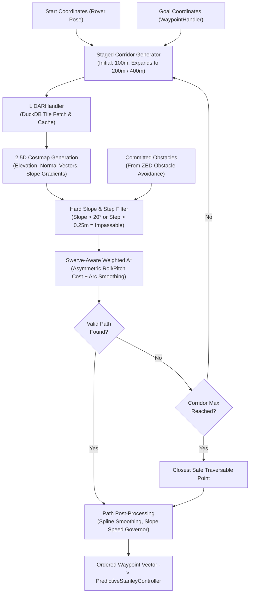

# Design Specification: Better Pathing & Incline Traversal Engine

**Authors:** Luke K (Autonomy Lead), Peyton (Pathing Lead), Jordan Hoover  
**Date:** November 5, 2026  
**Status:** Approved  
**Target Milestone:** Software Critical Design Review (CDR) - November 14, 2026  
**Subsystems Affected:** `GeoPlanner`, `AStar`, `NavigatingState`, `ApproachingMarkerState`, `WaypointHandler`, Obstacle Avoidance Interface, Swerve Kinematics Interface

---

## 1. Executive Summary & Problem Context

In previous competition years, the University Rover Challenge (URC) Autonomous Navigation Mission focused on wide-area flat desert traversals with approximate GPS coordinates, followed by spiral search patterns to locate markers.

For URC 2027, the rules introduce the **Autonomous Route-Finding Sub-Mission** (Rules Section 1.e.xii through 1.e.xviii), presenting a fundamentally different navigation challenge:
1. **Steep Natural Desert Hills (Section 1.e.xv):** Target 1 is located atop a hill selected specifically such that not all approach vectors are traversable; Autonomy must evaluate terrain slopes and contours to identify an achievable ascent route.
2. **Non-Line-of-Sight Behind Hill (Section 1.e.xvi):** Target 2 is situated behind the hill, cutting off radio line-of-sight with the command station. The rover must route and replan completely autonomously.
3. **Exact GNSS Coordinates (URC Q&A #16):** Target locations are exact; the primary challenge shifts from *searching* to *traversing difficult topography*.

### The Problem in Existing Software
During early simulation testing for CDR, the team discovered critical vulnerabilities in the current path planning codebase:
* **The "Path Through a Cliff" Bug:** In `GeoPlanner.cpp`, terrain traversal scores only apply soft exponential penalties. When climbing a 10-meter vertical cliff face has a lower heuristic cost than driving a 200-meter detour around a mountain, A* routes directly up vertical rock walls.
* **Lack of Dynamic Replanning:** If obstacle avoidance detects an unmapped boulder or washout, Autonomy has no mechanism to reject the corridor and compute a global macro-replan.
* **Disconnection in Approaching State:** `ApproachingMarkerState` previously drove in a straight line toward visual markers without consulting terrain slope, creating cliff drop-off hazards on hillsides.
* **Kinematic Mismatch with Swerve Drive:** The planner assumed a 6-wheel unicycle differential-drive model. In 2027, MRDT is deploying a **4-wheel Swerve Drive**, enabling diagonal traversing, zero wheel scrub, and distinct pitch/roll stability characteristics.

This specification establishes the architectural definition, algorithmic core, obstacle interfaces, and testing roadmap for the **Better Pathing** project.

---

## 2. Project Scope & Subsystem Boundaries

To prevent scope creep and provide Peyton and Jordan with clear project ownership, the project boundaries are strictly demarcated:

```
+----------------------------------------------------------------------------------------------------+
|                                    BETTER PATHING PROJECT BOUNDARIES                               |
+------------------------------------+---------------------------------------------------------------+
| IN SCOPE (Peyton & Jordan Owns)    | OUT OF SCOPE (Handed Off to Other Teams)                      |
+------------------------------------+---------------------------------------------------------------+
| • Global GeoPlanner A* algorithm   | • State Machine Flow & Transitions (Owned by Luke)            |
| • Hard slope & cliff gating        | • ZED Point Cloud Obstacle Extraction (Owned by Sam & Simon)  |
| • Staged corridor expansion        | • USGS DuckDB Database Storage / Loading (Owned by LiDAR team)|
| • Two-tier macro-replanning engine | • Low-Level Swerve Motor Controllers (Owned by Drive / Aiden) |
| • Swerve pitch vs roll cost model  | • Search Pattern Scan Routine (Owned by State Machine)        |
| • ApproachingMarker local pathing  |                                                               |
+------------------------------------+---------------------------------------------------------------+
```

---

## 3. Algorithmic Architecture



---

## 4. Technical Specifications & Mathematical Formulations

### 4.1 Hard Slope Kinematic Gating (Eliminating the Cliff Bug)
In `src/algorithms/planners/GeoPlanner.cpp`, soft cost weighting is augmented with **strict kinematic rejection thresholds**:

1. **Longitudinal Slope Limit:** Between current cell $(x_c, y_c, z_c)$ and candidate neighbor $(x_n, y_n, z_n)$:
   $$\Delta d_{\text{planar}} = \sqrt{(x_n - x_c)^2 + (y_n - y_c)^2}$$
   $$\Delta z = |z_n - z_c|$$
   $$\theta_{\text{slope}} = \arctan\left(\frac{\Delta z}{\Delta d_{\text{planar}}}\right)$$
   $$\text{If } \theta_{\text{slope}} > \theta_{\text{max\_climb}} \ (20.0^\circ), \quad \text{REJECT NEIGHBOR (Impassable)}$$
2. **Vertical Step Height Limit:** To prevent high-centering on jagged rock ledges:
   $$\text{If } \Delta z > h_{\text{step\_max}} \ (0.25\text{ m}), \quad \text{REJECT NEIGHBOR (Impassable)}$$
3. **Minimum Traversal Score Cutoff:**
   `m_dMinTravScore` is raised from `0.0` to `0.35`. Any cell evaluated with composite score below this threshold is immediately skipped.

### 4.2 Staged Corridor Expansion
When hills or canyon walls block the direct corridor:
* `GeoPlanner` begins with baseline corridor padding:
  $$d_{\text{corridor}} = 100.0\text{ meters}$$
* If A* exhausts open nodes without reaching the goal, the planner automatically expands the search corridor in stages:
  $$\text{Stage 1: } 100\text{ m} \longrightarrow \text{Stage 2: } 200\text{ m} \longrightarrow \text{Stage 3: } 400\text{ m}$$
  This provides the search space required to find natural saddles, passes, and ridge routes around mountains without manual operator intervention.
* **Closest-Approach Fallback:** If Stage 3 fails, the planner reconstructs the path to the evaluated node that minimized Euclidean distance to the goal, allowing the rover to make safe forward progress rather than aborting to `eIdle`.

### 4.3 Swerve Incline Kinematics: Pitch vs. Roll Asymmetry
On natural desert hills, a 4-wheel rover's static stability limit in lateral roll ($\approx 25^\circ$) is significantly lower and more catastrophic than its limit in longitudinal pitch ($\approx 35^\circ$). Traversing horizontally along the side of a steep hill (side-hilling) creates severe rollover and lateral downhill slide hazards.

The 2.5D cost evaluation decomposes surface gradient into heading-aligned pitch and perpendicular cross-slope roll:
$$C_{\text{incline}} = 1.0 + w_{\text{pitch}} \cdot \left(\frac{\theta_{\text{pitch}}}{\theta_{\text{max\_climb}}}\right)^2 + w_{\text{roll}} \cdot \left(\frac{\theta_{\text{roll}}}{\theta_{\text{max\_roll}}}\right)^4$$

Where:
* $\theta_{\text{max\_climb}} = 20.0^\circ$, $w_{\text{pitch}} = 2.0$
* $\theta_{\text{max\_roll}} = 15.0^\circ$, $w_{\text{roll}} = 8.0$ (Heavily penalized with power-4 growth)

**Behavioral Result:** A* naturally avoids traversing sideways across steep cliffs and actively prefers either direct uphill climbs or gentle diagonal switchbacks.

---

## 5. Integration with Obstacle Avoidance & Replanning Architecture

### 5.1 Two-Tier Replanning Policy

```
[Real-Time ZED Point Cloud] ---> [Obstacle Avoidance (Sam & Simon)]
                                          |
                      +-------------------+-------------------+
                      |                                       |
             Small Isolated Hazard                   Corridor Blockage
              (< 1.0m width)                       (Cross-Track > 5.0m OR Halt)
                      |                                       |
                      v                                       v
         [Tier 1: Micro-Avoidance]                [Tier 2: Macro-Replanning]
       (Local path tracker nudges              (Commit obstacle to WaypointHandler,
        lateral steering vector)                trigger GeoPlanner from current pose)
```

1. **Tier 1 (Local Micro-Avoidance):**  
   Handled in the trajectory controller. If an obstacle is detected within $3.0$ meters of the path but clear corridor space exists adjacent, the controller applies a local potential field nudge without discarding the global path.
2. **Tier 2 (Global Macro-Replanning):**  
   Triggered under any of the following conditions:
   * The obstacle completely spans the drivable corridor width.
   * Local avoidance requires a lateral deviation $>5.0$ meters off the global centerline.
   * Forward velocity drops below $0.05$ m/s for $>3.0$ seconds due to path obstruction.
   
   **Execution:**
   1. The obstacle is committed into `WaypointHandler::AddObstacle()`.
   2. `NavigatingState` immediately invokes `GeoPlanner::PlanPath(pLiDAR, CurrentPose, GoalWaypoint)`.
   3. The newly generated path replaces `"GeoPlannerPath"` in `WaypointHandler` and updates the controller.

### 5.2 Operator Controls & Safety Overrides
To assist field and bench testing, macro-replanning behavior is configurable via runtime constants and RoveComm commands:
```cpp
namespace constants
{
    const bool ENABLE_MACRO_REPLANNING                     = true;
    const double MACRO_REPLAN_CROSS_TRACK_THRESHOLD_METERS = 5.0;
    const double MACRO_REPLAN_STALL_TIME_SECONDS           = 3.0;
    const double MAX_SAFE_CLIMBING_SLOPE_DEGREES           = 20.0;
    const double MAX_SAFE_ROLL_SLOPE_DEGREES               = 15.0;
    const double MAX_SAFE_STEP_HEIGHT_METERS               = 0.25;
}
```

---

## 6. Approaching Marker Local Planning (`eApproachingMarker`)

To resolve the vulnerability identified in `MRDT Better Pathing doc.md` where `ApproachingMarkerState` drove straight toward tags regardless of terrain:

1. When `eApproachingMarker` is active, it queries the local LiDAR costmap within a 5-meter radius around the ArUco post.
2. The approach vector is evaluated for slope safety. If a direct straight approach requires traversing a slope $>20.0^\circ$ (e.g., tag is on the edge of a steep drop-off), the local planner computes a lateral swerve docking arc.
3. Swerve drive translates laterally to approach the post from an accessible, gentle contour angle.

---

## 7. Concrete Testing Roadmap & Real-World Sites

To provide Peyton and Jordan with a definitive answer to *"How and where will we test this in real life?"*:

```
+----------------------------------------------------------------------------------------------------+
|                                    BETTER PATHING TESTING PIPELINE                                 |
+--------------------+---------------------------+---------------------------------------------------+
| Stage              | Location / Platform       | Verification Focus                                |
+--------------------+---------------------------+---------------------------------------------------+
| Stage 1: Sim       | Unreal Engine Simulator   | • Cliff rejection: rover refuses vertical climb   |
|                    | (MDRS Utah Elevation Map) | • Staged corridor expansion around mountain       |
|                    |                           | • Dynamic macro-replan when barrier is spawned    |
+--------------------+---------------------------+---------------------------------------------------+
| Stage 2: Unit/CI   | Catch2 Test Suite         | • Automated A* regression tests on USGS DuckDB    |
|                    | (Developer PC / CI)       | • Validates compute time < 5.0s on 200m corridor  |
|                    |                           | • Ensures max slope in generated path <= 20.0 deg |
+--------------------+---------------------------+---------------------------------------------------+
| Stage 3: Field 1   | Fugitive Beach Quarry     | • Real desert/quarry limestone topography         |
|                    | (Rolla, MO)               | • Swerve traction and switchbacking on sand/rock  |
|                    |                           | • Live LiDAR + ZED obstacle detection             |
+--------------------+---------------------------+---------------------------------------------------+
| Stage 4: Field 2   | S&T Experimental Mine     | • Steep gravel berms and rocky incline routes     |
|                    | (Rolla, MO)               | • Multi-waypoint hill navigation trials           |
+--------------------+---------------------------+---------------------------------------------------+
| Stage 5: Full Run  | RoveLot / Rolla Parks     | • End-to-end 40-minute mission integration run    |
|                    |                           | • Astronaut assistance hand-off to route-finding  |
+--------------------+---------------------------+---------------------------------------------------+
```

---

## 8. Software CDR Slide Alignment Matrix (Slide 12)

This specification provides direct, technical answers to all four questions posed for the Software CDR:

1. **How and where will we test this in real life?**  
   * Staged progression starting in Unreal Engine with MDRS terrain heightmaps, validated via Catch2 offline benchmarks, and field-tested on real inclines and gravel mounds at **Fugitive Beach Quarry** and the **S&T Experimental Mine**.
2. **What specifically are you doing so that this pathing is "better"?**  
   * Hard slope feasibility cutoffs ($>20^\circ$) preventing paths up cliffs.
   * Staged corridor expansion ($100\text{m} \rightarrow 200\text{m} \rightarrow 400\text{m}$) to autonomously find ridges and saddles.
   * Swerve-optimized asymmetric cost functions penalizing lateral roll ($>15^\circ$) while enabling smooth arc trajectories.
   * Slope-aware velocity scaling for traction control.
3. **How will this be integrated with obstacle avoidance?**  
   * Two-tier replanning policy: local micro-nudges handle isolated boulders under 3m; persistent corridor blockages (> 5m cross-track error or halted motion) trigger automated global `GeoPlanner` macro-replanning.
4. **Where will this code be used? Astronaut mission, or only the AR tag portion?**  
   * `GeoPlanner` is the global navigation engine for **both** missions. It guides the initial transit to the astronaut (Task 1.e.v) and the hill ascents to Target 1 and Target 2. During the close-range astronaut sub-mission, global pathing pauses while local visual servoing controls movement.
