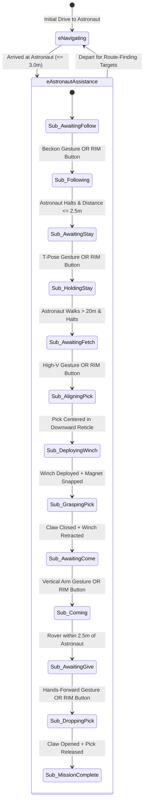

# Design Specification: Command Plans & Astronaut Assistance Pipeline

**Author:** Luke K (Autonomy Lead)  
**Date:** November 5, 2026  
**Status:** Approved  
**Target Milestone:** Software Critical Design Review (CDR) - November 14, 2026  
**Subsystems Affected:** Autonomy Core State Machine, Perception / Vision Pipeline, Networking (RoveComm), Mechanical Autohead / Gripper, Spacesuit Electronics (RIM)

---

## 1. Executive Summary & Problem Context

The University Rover Challenge (URC) 2027 Autonomy Mission introduces a 50-point **Astronaut Assistance Sub-Mission** (Rules Section 1.e.iv through 1.e.xi). In this task, the rover must assist an astronaut in the field through a strict sequence of 5 distinct operational commands: `Follow!`, `Stay!`, `Fetch!`, `Come!`, and `Give!`.

Previous Autonomy architectures were structured around flat, point-to-point GNSS traversal and ArUco marker searches. The 2027 rules require interactive human-robot collaboration, visual pose interpretation, precision close-range tool manipulation, and cross-subsystem coordination between the rover, an astronaut suit, and the base station.

This document specifies the technical design, software architecture, perception pipeline, actuation interfaces, and error recovery protocols for executing all five astronaut assistance commands.

---

## 2. Regulatory Ground Truth & Rules Analysis

All architectural decisions are anchored in the official **URC 2027 Rules** and the **URC Autonomy Q&A**:

1. **Scoring Breakdown by Modality (URC Q&A #6):**
   * **`Follow!` is the ONLY command where gesture recognition yields higher points:**
     * Visual Beckoning Gesture: **15 points** (Full value)
     * Spoken Voice Audio: **10 points** (2/3 value)
     * Device-based Button / Visual Sign: **5 points** (1/3 value)
   * **`Stay!` (5 pts), `Fetch!` (10 pts), `Come!` (5 pts), and `Give!` (5 pts) award FULL POINTS regardless of command modality.**
2. **Command Sequencing (URC Q&A #13):**
   * Commands must be executed in strict sequence: `Follow!` -> `Stay!` -> `Fetch!` -> `Come!` -> `Give!`.
3. **Physical Distances & Tolerances (URC Q&A #7, #10, #16, #29):**
   * Initial Rendezvous (`Drive to Astronaut`): Stop within **3.0 meters** of GNSS point (5 pts).
   * `Follow!` Halting Distance: Stop within **3.0 meters** of the halted astronaut.
   * `Stay!` Separation: Astronaut walks **$>20$ meters** away; rover must remain completely motionless.
   * `Fetch!` & `Come!` Origins: The astronaut commands both actions from **$\ge 20$ meters away** directly within the rover's field of view.
   * `Come!` Halting Distance: Stop within **3.0 meters** of the astronaut.
4. **Gesture Constraints (URC Q&A #11):**
   * Finger and facial gestures are strictly prohibited. Gestures are limited to arm, leg, and torso motions.
5. **Abort & Retry Rules (URC Section 1.e.xi & Q&A #30):**
   * **Autonomous Recovery (0% penalty):** If the rover autonomously detects a failure (e.g., misses tool grasp, loses tracking), it may stop or re-attempt the task with zero penalty. Commands may be autonomously re-issued.
   * **C2 Operator Signal Abort (20% penalty):** Manual signal to abort/restart from base station.
   * **Teleoperation Return (50% penalty):** Manual driving override.

---

## 3. High-Level Architecture: The Sub-State Machine Pattern

### 3.1 Architectural Decision: Sub-State Machine vs. Flat States
* **Chosen Approach:** Sub-State Machine (`AstronautMissionController`) encapsulated inside a single top-level `eAstronautAssistance` state.
* **Trade-Off Analysis & Justification:**
  * *Option Considered (Flat States in `StateMachineHandler`):* Adding 5 to 10 top-level states (`eFollowAstronaut`, `eStay`, `eFetchTool`, etc.) clutters the 60 Hz main loop with states only active during a 15-minute competition window. It couples global error handlers, stuck detection, and obstacle avoidance unnecessarily.
  * *Selected Design:* An isolated `AstronautMissionController` runs inside `eAstronautAssistance`. It manages state transitions internally, enforces sequential gating, and reports high-level events to the top-level state machine.

### 3.2 State Machine Flow Diagram



---

## 4. Command Plans Detailed Specification

### 4.1 Command 1: Follow!
* **Activation Condition:** Rover is parked $\le 3.0$ m from the astronaut following the initial drive leg; state is `Sub_AwaitingFollow`.
* **Primary Trigger:** Visual Beckoning Gesture (Single arm raised and bent at elbow, waving toward shoulder). Verified across 3 consecutive frames (~100 ms).
* **Fallback Trigger:** Handheld Rover Interface Module (RIM) button press transmitting RoveComm packet `CMD_FOLLOW`.
* **Execution Logic:**
  * Rover activates `PredictiveStanleyController` / swerve path tracking.
  * *Coarse Heading:* Polling the suit's GNSS coordinates over Wi-Fi keeps the rover's front ZED camera oriented toward the walking astronaut.
  * *Ranging & Braking:* Front ZED 3D depth clustering tracks the person's Euclidean distance. Speed scales proportionally, maintaining a 2.0 to 2.5-meter standoff distance.
* **Exit / Completion Criteria:** The astronaut halts. Once the distance closes to $\le 2.5$ m and the astronaut remains stationary for 2.0 seconds, the rover commands a full stop, flashes the rear green LED for 3.0 seconds, and transitions to `Sub_AwaitingStay`.

### 4.2 Command 2: Stay!
* **Activation Condition:** Rover is stopped $\le 3.0$ m from the astronaut; state is `Sub_AwaitingStay`.
* **Primary Trigger:** Dual-active: Horizontal "T-pose" gesture OR Handheld RIM button press (`CMD_STAY`).
* **Execution Logic:**
  * Drivetrain motors are locked with zero-power hold commands.
  * Dynamic obstacle avoidance and person tracking are temporarily suspended.
  * State enters an idle monitoring loop while the astronaut walks away.
* **Exit / Completion Criteria:** The astronaut walks $>20.0$ m away (measured by Suit GNSS distance and ZED tracking). Rover remains completely motionless and transitions to `Sub_AwaitingFetch`.

### 4.3 Command 3: Fetch!
* **Activation Condition:** Rover is stationary in `Stay` hold; astronaut is $\ge 20.0$ m away; state is `Sub_AwaitingFetch`.
* **Primary Trigger:** Handheld RIM button press (`CMD_FETCH`) OR Overhead High "V-pose" gesture.
* **Execution Logic (Three-Stage Visual Servoing):**
  1. *Stage 1 (Coarse Front Approach):* Front ZED camera detects `RockPick` via YOLO model. Rover computes planar ground vector via `GeolocateBox()` and translates forward until the pick passes beneath the front bumper (~0.8 m range).
  2. *Stage 2 (Downward Camera Centering via Swerve Strafe):* Under-chassis downward camera (`eAutoheadDownwardCam`) activates along with under-chassis LED illumination. An image-space visual servoing loop measures pixel error $(\Delta x, \Delta y)$ from calibrated autohead center:
     $$v_x = k_x \Delta x, \quad v_y = k_y \Delta y$$
     The swerve drive translates directly in 2D Cartesian space without rotating until the pick is within $\pm 20$ mm of center.
  3. *Stage 3 (Winch & Claw Manipulation):* `AutoheadDriver` powers the 24V winch down. When the electromagnet contacts the steel hammer head (verified by current draw / contact sensor), the continuous rotation servo closes the claw jaws. The winch retracts until the home limit switch triggers.
* **Exit / Completion Criteria:** Winch is fully raised, and optical/current sensors confirm the tool is securely seated in the autohead dock. Flashes Green LED for 3.0 seconds and transitions to `Sub_AwaitingCome`.

### 4.4 Command 4: Come!
* **Activation Condition:** Rock pick is secured in autohead dock; astronaut is $\ge 20.0$ m away; state is `Sub_AwaitingCome`.
* **Primary Trigger:** Handheld RIM button press (`CMD_COME`) OR Vertical one-arm raised gesture.
* **Execution Logic:**
  * Rover extracts the astronaut's live GNSS coordinate from the suit's 5 Hz telemetry stream.
  * Swerve drive turns to face the coordinate vector and accelerates to cruising speed ($1.0 - 1.5$ m/s).
  * At 10.0 meters range, front ZED camera acquires the astronaut visually and takes over longitudinal velocity braking:
     $$v_{\text{cmd}} = \text{clamp}(k_p (d_{\text{depth}} - 2.5), 0.0, v_{\text{max}})$$
* **Exit / Completion Criteria:** Rover halts completely within $2.0 - 2.5$ meters of the astronaut (satisfying the $\le 3.0$ m requirement). Flashes Green LED for 3.0 seconds and transitions to `Sub_AwaitingGive`.

### 4.5 Command 5: Give!
* **Activation Condition:** Rover is parked $\le 3.0$ m from astronaut with tool held; state is `Sub_AwaitingGive`.
* **Primary Trigger:** Handheld RIM button press (`CMD_GIVE`) OR Hands-extended-forward gesture.
* **Execution Logic:**
  * `AutoheadDriver` opens the mechanical servo jaws and de-energizes the electromagnet.
  * Downward camera verifies that the tool has dropped to the ground.
* **Exit / Completion Criteria:** Tool is clear of the gripper and rests on the ground. Rover flashes Green LED for 3.0 seconds and transitions to `Sub_MissionComplete`.

---

## 5. Perception Pipeline & Pose Model Specification

### 5.1 Static Geometric Poses vs. Temporal Tracking
Dynamic gestures (requiring video stream optical flow or recurrent neural networks like LSTMs) introduce significant latency and failure modes in desert field conditions. 

The perception pipeline uses **single-frame static geometric poses** processed through a **3-frame temporal debounce filter** (~100 ms at 30 fps). A gesture is only verified when classified with $>80\%$ confidence across 3 consecutive frames.

```
Frame t-2: Pose == HIGH_V (conf: 0.88)
Frame t-1: Pose == HIGH_V (conf: 0.91)
Frame t:   Pose == HIGH_V (conf: 0.93)
--> TRIGGER EVENT DISPATCHED: eFetchTriggered
```

### 5.2 Geometric Pose Set Definitions

```
      Follow (< 3m)            Stay (< 3m)             Fetch (20m+)
          O                        O                        \ O /
        / | \                    --|--                       \|/
          |                        |                          |
         / \                      / \                        / \
   (One arm bent up)         (T-Pose arms)              (High-V arms)

       Come (20m+)             Give (< 3m)
          | O                      O
          |/|                      |-- (Hands forward)
            |                      |
           / \                    / \
     (One arm up)          (Receiving posture)
```

1. **Follow (< 3m):** One arm bent at elbow, hand near head level (beckon wave).
2. **Stay (< 3m):** Both arms extended laterally horizontally at $90^\circ$ ("T-pose").
3. **Fetch (20m+):** Both arms raised high overhead at $45^\circ$ angles ("High-V"). Distinct silhouette even when the human is only 80 pixels high in the image at 20 meters.
4. **Come (20m+):** One arm extended straight up vertically, opposite arm at side.
5. **Give (< 3m):** Both arms extended forward at chest/waist level (holding out hands to receive).

### 5.3 Model Training & Roboflow Pipeline (Kara & Thomas / Oscar & Saurav)
* **Model Framework:** YOLOv8-pose exported to TorchScript / TensorRT for direct C++ execution inside `TorchObjectDetection.hpp`.
* **Dataset Size & Annotation:**
  * 1,200 to 1,500 annotated images spanning standard astronaut coveralls across diverse desert lighting (direct sun, backlit sun, side glare, dawn/dusk).
  * 17-point COCO keypoint skeleton format.
  * Augmentations: Random contrast, motion blur, synthetic dust, solar flare simulation.
* **Model Storage:** Approx. 15 to 25 MB (FP16 TorchScript/Engine), negligible impact on Jetson storage.

---

## 6. Hardware, Electrical & Network Interfaces

### 6.1 Actuation Strategy: Rejection of Jetson GPIO & Adoption of RoveComm

A direct Jetson AGX Orin 40-pin GPIO interface was investigated and rejected for the following engineering reasons:
1. **Electrical Safety:** Jetson GPIO is strictly 3.3V LVCMOS with 1 to 4 mA maximum drive current. Driving high-current 24V winch motors, inductive electromagnets, or 5V servos directly from the header will instantly destroy the Jetson's SoC.
2. **Real-Time Encoder Timing:** The 24V winch motor relies on quadrature encoder feedback to prevent over-spooling. Userspace Linux cannot service kHz-frequency encoder interrupts deterministically.
3. **Safety Watchdogs:** Embedded motor controllers (smocos) feature hardware watchdogs that shut off power if packets stop. Jetson GPIO lines latch high if Autonomy crashes.
4. **Platform Agnosticism & Simulation:** Hardcoding Jetson GPIO breaks execution inside the Unreal Engine simulator and on non-Jetson developer laptops.

**Selected Architecture:** Autonomy interacts with all autohead actuation via a dedicated driver class: **`AutoheadDriver`** (`src/drivers/AutoheadDriver.h`), dispatching RoveComm packets over UDP/CAN to MRDT's Smart Motor Controller (smoco) and Core Board.

### 6.2 RoveComm Telemetry & Command Manifest Additions

```json
{
  "Autohead": {
    "Ip": "192.168.1.130",
    "Commands": {
      "AutoheadWinchCommand": {
        "dataId": 3020,
        "dataType": "FLOAT_T",
        "dataCount": 1,
        "comments": "Winch drive effort (-1.0 to 1.0) -> Down/Up"
      },
      "AutoheadGripperCommand": {
        "dataId": 3021,
        "dataType": "UINT8_T",
        "dataCount": 1,
        "comments": "Claw state (0: Open, 1: Close/Grip)"
      },
      "AutoheadMagnetState": {
        "dataId": 3022,
        "dataType": "UINT8_T",
        "dataCount": 1,
        "comments": "Electromagnet power (0: Off, 1: On)"
      },
      "AutoheadLightState": {
        "dataId": 3023,
        "dataType": "UINT8_T",
        "dataCount": 1,
        "comments": "Under-chassis LED illuminator (0: Off, 1: On)"
      }
    },
    "Telemetry": {
      "AutoheadWinchPosition": {
        "dataId": 3120,
        "dataType": "FLOAT_T",
        "dataCount": 1,
        "comments": "Encoder depth in meters from home switch"
      },
      "AutoheadGripperCurrent": {
        "dataId": 3121,
        "dataType": "FLOAT_T",
        "dataCount": 1,
        "comments": "Gripper motor current draw (amperes)"
      }
    }
  },
  "Astronaut": {
    "Ip": "192.168.1.135",
    "Commands": {
      "AstronautCommand": {
        "dataId": 12011,
        "dataType": "UINT8_T",
        "dataCount": 1,
        "comments": "Command trigger enum (1: Follow, 2: Stay, 3: Fetch, 4: Come, 5: Give)"
      }
    },
    "Telemetry": {
      "AstronautGPS": {
        "dataId": 12010,
        "dataType": "DOUBLE_T",
        "dataCount": 3,
        "comments": "[Latitude, Longitude, Altitude]"
      },
      "AstronautFeedback": {
        "dataId": 12012,
        "dataType": "UINT8_T",
        "dataCount": 2,
        "comments": "[ActiveSubState, StatusFlag]"
      }
    }
  }
}
```

### 6.3 Downward Camera Interface
* Physical connection: Standard USB 3.0 / UVC camera mounted on the underside of the autohead.
* Software interface: Read directly via `BasicCam` (`src/vision/cameras/BasicCam.h`) through V4L2 in OpenCV.
* Registration: Added to `CameraHandler::BasicCamName::eAutoheadDownwardCam`.

---

## 7. Dual-Channel Feedback Protocol

To ensure both the astronaut in the field and judges have immediate situational awareness:

1. **Judges (External Chassis Lighting - URC Rule 1.e.ii):**
   * **Solid Red:** Sub-state machine is active and executing autonomous behavior.
   * **Flashing Green:** Triggered for exactly 3.0 seconds upon reaching each milestone:
     * Halting within 3m during `Follow!`.
     * Successfully securing the rock pick during `Fetch!`.
     * Halting within 3m during `Come!`.
     * Depositing the tool during `Give!`.
   * **Solid Blue:** Teleoperation active (manual override).
2. **Astronaut (Handheld RIM Feedback):**
   * The 4" touch LCD on Tim Lipina's handheld unit receives the 10 Hz `AstronautFeedback` telemetry packet.
   * Displays the current active sub-state in high-contrast text (e.g., `AWAITING FOLLOW`, `FOLLOWING (2.4m)`, `FETCHING PICK`, `COME (18.2m)`).
   * Displays an immediate visual checkmark when a gesture or button press is accepted.

---

## 8. Failure Modes, Edge Cases & Recovery

| Failure Mode | Trigger / Condition | Autonomous Mitigation (0% Penalty) | Operator Fallback |
| :--- | :--- | :--- | :--- |
| **False Pose Detection / Noise** | Vision detects partial match ($<80\%$) or unstable pose ($<3$ frames). | Rover ignores detection and remains in current waiting sub-state. | Astronaut holds pose firmly or presses the physical RIM button. |
| **Tracking Lost during `Follow`** | Astronaut turns $90^\circ$ around a boulder; ZED loses visual bounding box. | Rover stops forward drive immediately. Steers chassis toward Suit GNSS coordinate vector until astronaut re-enters FOV. | Re-acquire visual lock and resume follow. |
| **Pick Missed / Dropped during `Fetch`** | Winch retracts without pick contact or pick slips from jaws before stow. | Downward camera detects pick still on ground. Rover resets winch, re-centers, and re-drops claw. | Astronaut re-issues `Fetch` command autonomously (Q&A #30). |
| **Over-distance in `Come`** | Front camera blinded by sun glare while closing distance. | Blind GPS fallback decelerates rover to full stop when differential GPS distance $\le 2.5$ m. | Visual reacquisition or C2 soft stop (20% penalty if C2 intervenes). |
| **Winch Cable Snag / Motor Stall** | Encoder fails to advance while winch motor is powered. | Smoco current limit trips; sends error telemetry. Autonomy reverses winch 20 mm to clear snag. | Abort sub-task to prevent mechanical damage. |

---

## 9. Alignment with Software CDR Expectations (Slide 9 & 13)

This design directly answers all technical questions posed in the Software CDR review agenda:

1. **Activation Conditions & Code Locations:** Enforced sequentially inside `AstronautMissionController.cpp` under top-level state `eAstronautAssistance`.
2. **Actuation Signaling for Fetch & Give:** Dispatched via `AutoheadDriver` over RoveComm to Smoco / Core Board (Data IDs 3020–3023).
3. **Downward Camera Integration:** Handled via OpenCV `BasicCam` wrapped in `CameraHandler`.
4. **Gesture Set & 20m Detection:** Distance-differentiated gross geometric poses using high visual silhouettes (High-V and Vertical Arm) with 3-frame debounce.
5. **Button vs. Gesture Redundancy:** Full points awarded for button triggers on tasks 2–5 per URC Q&A #6, providing guaranteed competition execution.
