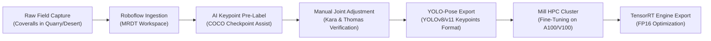
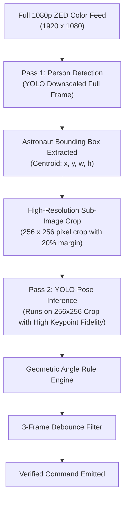

# Design Specification: Astronaut Pose Model Creation & Verification Pipeline

**Authors:** Luke K (Autonomy Lead), Kara, Thomas  
**Date:** November 5, 2026  
**Status:** Approved  
**Target Milestone:** Software Critical Design Review (CDR) - November 14, 2026  
**Subsystems Affected:** `src/vision/pose/PoseDetector`, `src/handlers/ObjectDetectionHandler`, `AstronautMissionController`, Roboflow Dataset Pipeline, TensorRT / TorchScript Export Engine

---

## 1. Executive Summary & Problem Context

The University Rover Challenge (URC) 2027 Autonomy Mission introduces the **Astronaut Assistance Sub-Mission**, requiring the rover to assist an astronaut in the field through five sequential tasks: `Follow!`, `Stay!`, `Fetch!`, `Come!`, and `Give!`. 

* **The Scoring Driver (URC Q&A #6):** For the `Follow!` command, using visual gesture recognition awards **15 points** (full value), whereas verbal speech awards 10 points (2/3 value) and a handheld device awards only 5 points (1/3 value). 
* **The Gesture Constraints (URC Q&A #11):** Facial expressions and finger/hand gestures are strictly prohibited due to EVA suit restrictions. Gestures are limited strictly to gross arm, leg, and torso motions.
* **The Environmental Challenges:** The rover must detect these poses against harsh desert badlands, blinding sunlight, low-contrast shadows, and over distances ranging from close proximity ($<3.0$ meters) to **over 20 meters away** (`Fetch!` and `Come!`).

This specification establishes the end-to-end architecture for the **Pose Model Creation** project led by Kara and Thomas, detailing model architecture, Roboflow dataset construction, geometric joint-angle classification, long-range (20m) visual strategies, model storage footprint, and C++ autonomy integration.

---

## 2. Regulatory & Technical Ground Truth

1. **URC Rules Section 1.e.vi & Q&A #6:**
   * Only `Follow!` scales points by modality. `Stay!`, `Fetch!`, `Come!`, and `Give!` award full points regardless of command modality (gesture, voice, or handheld button).
2. **URC Q&A #7 & #10:**
   * For `Stay!`, the astronaut walks $>20$ meters away.
   * For `Fetch!` and `Come!`, the astronaut will be **at least 20 meters away** from the rover, directly within the rover's field of view.
3. **URC Q&A #11:**
   * Gestures are limited strictly to arm, leg, and torso motions. No finger or facial signals.
4. **URC Q&A #12:**
   * The team's EVA suit consists of coveralls, cooling backpack, and helmet. The suit may have distinct colors or patterns to aid computer vision.

---

## 3. Model Architecture Selection

### 3.1 Primary Model: Fine-Tuned YOLOv11-Pose / YOLOv8-Pose
* **Architecture:** Single-stage feed-forward convolutional neural network with decoupled pose head predicting bounding box coordinates, objectness, and 17 COCO body keypoints $(x_i, y_i, \text{conf}_i)$ simultaneously.
* **Base Foundation Checkpoint:** Pre-trained on Microsoft COCO (200,000+ human instances). The team does not train from scratch; instead, we perform **domain adaptation fine-tuning** on custom MRDT astronaut coverall imagery.
* **Inference Engine:** Exported to **TensorRT FP16 `.engine`** for hardware-accelerated execution on the Jetson AGX Orin's Ampere GPU cores.

### 3.2 Evaluation of Alternatives & Trade-Offs

```
+------------------------------------+--------------------+--------------------+----------------------+
| Metric                             | YOLO-Pose (Chosen) | ZED SDK Native API | Video 3D CNN (I3D)   |
+------------------------------------+--------------------+--------------------+----------------------+
| Baggy Coveralls / Suit Invariance  | High (Custom data) | Medium (Generic)   | Medium               |
| Long-Range Tracking (20m+)         | High (2D crop pass)| Poor (>12m dropoff)| Low (Resolution drop)|
| Simulator (Unreal Engine) Support  | Full (Standard RGB)| Poor (Needs ZED)   | Full                 |
| Inference Frame Rate (Jetson Orin) | 60 - 90 FPS        | 30 FPS             | 10 - 15 FPS          |
| Model Storage Size                 | 3.5 - 15 MB        | Bundled in SDK     | > 150 MB             |
| Temporal Overhead / Latency        | Zero (Single-frame)| Low (Real-time)    | High (> 1000ms clips)|
+------------------------------------+--------------------+--------------------+----------------------+
```

* **Stereolabs ZED SDK Body Tracking (Alternative Consideration):** While zero-training, the ZED SDK stereo depth map degrades significantly beyond 12 to 15 meters in bright desert sunlight, causing severe joint jitter at 20 meters. It remains documented as a secondary experimental baseline.

---

## 4. Dataset Engineering & Roboflow Workflow

Following the proven dataset methodology established in MRDT's CS 5402 research paper (`RoveSoDataset`), dataset engineering prioritizes class balance and environmental diversity over raw image count.



### 4.1 Target Dataset Dimensions
* **Raw Image Target:** **800 to 1,200 unique photographs** of team members wearing the actual URC astronaut coveralls and cooling backpack.
* **Distance Distribution:**
  * Close Range ($1.0 - 3.0$ m): 30% of dataset (Follow, Stay, Give).
  * Medium Range ($5.0 - 12.0$ m): 30% of dataset (Transit, intermediate steps).
  * Long Range ($15.0 - 25.0$ m): 40% of dataset (Fetch, Come).
* **Lighting Distribution:** Direct sunlight, backlit sunset glare, deep shadows, and artificial dust haze.
* **Class Balance:** Exactly equal representation of the 5 operational static postures plus neutral standing/walking background classes to prevent false positive triggers.

### 4.2 Roboflow Keypoint Annotation Format
Images are annotated using the standard **COCO 17-Keypoint Skeleton Topology**:
1. Nose, 2. Left Eye, 3. Right Eye, 4. Left Ear, 5. Right Ear
6. Left Shoulder, 7. Right Shoulder, 8. Left Elbow, 9. Right Elbow, 10. Left Wrist, 11. Right Wrist
12. Left Hip, 13. Right Hip, 14. Left Knee, 15. Right Knee, 16. Left Ankle, 17. Right Ankle

* **Accelerated Labeling:** Roboflow's pre-trained keypoint assistant automatically suggests joint locations upon image upload. Members simply verify and drag misaligned points, increasing labeling throughput from 45 seconds/image to under 10 seconds/image.

### 4.3 Data Augmentation Pipeline
To generalize against desert environmental noise without ballooning manual labeling time, the training pipeline applies:
* **Photometric Distortions:** Random brightness ($\pm 25\%$), contrast adjustments ($\pm 20\%$), and color temperature shifts (simulating Utah noon versus golden hour).
* **Atmospheric Simulation:** Synthetic motion blur, camera shake, and Gaussian noise simulating dust storms.
* **Synthetic Scale Downsampling:** Random scaling ($0.25\times$ to $1.0\times$) downsampling the subject to train the network on small pixel silhouettes ($80-120$ pixels high).
* **Horizontal Flip:** With automatic joint index swapping ($L \leftrightarrow R$).

Total augmented dataset size: **2,500 to 3,500 training instances**.

---

## 5. Geometric Joint-Angle Rule Engine & Verification

Instead of training an opaque secondary neural network to classify the keypoints, pose classification is governed by a **Deterministic Geometric Joint-Angle Rule Engine** paired with a **Temporal Debounce Filter**.

### 5.1 Local Reference Frame Normalization
To make angle calculations invariant to camera distance, rover pitch/roll, or hillside slopes, all coordinates are transformed into the astronaut's **Torso-Normalized Reference Frame**:
* **Mid-Shoulder Origin:** $S_{\text{mid}} = \frac{1}{2}(S_L + S_R)$
* **Mid-Hip Base:** $H_{\text{mid}} = \frac{1}{2}(H_L + H_R)$
* **Torso Vertical Vector:** $\vec{V}_{\text{torso}} = S_{\text{mid}} - H_{\text{mid}}$
* **Torso Length Scale:** $L_{\text{torso}} = \|\vec{V}_{\text{torso}}\|$

All joint coordinates are expressed relative to $S_{\text{mid}}$ and scaled by $L_{\text{torso}}$.

### 5.2 Command Angle Thresholds

```
      Follow (< 3m)            Stay (< 3m)             Fetch (20m+)
          O                        O                        \ O /
        / | \                    --|--                       \|/
          |                        |                          |
         / \                      / \                        / \

       Come (20m+)             Give (< 3m)
          | O                      O
          |/|                      |-- (Hands forward)
            |                      |
           / \                    / \
```

1. **Follow! (Beckon Posture):**
   * One elbow flexed: Angle $(S_{\text{arm}}, E_{\text{arm}}, W_{\text{arm}}) \le 90.0^\circ$.
   * Wrist elevated: $y(W_{\text{arm}}) < y(S_{\text{arm}})$ (wrist above shoulder line).
   * Opposite arm relaxed at side: Angle $(V_{\text{torso}}, \vec{S_{\text{opp}} \rightarrow E_{\text{opp}}}) \le 25.0^\circ$.
2. **Stay! (Horizontal T-Pose):**
   * Both arms abducted laterally: Angle $(V_{\text{torso}}, \vec{S_L \rightarrow E_L}) = 90.0^\circ \pm 15.0^\circ$ and Angle $(V_{\text{torso}}, \vec{S_R \rightarrow E_R}) = 90.0^\circ \pm 15.0^\circ$.
   * Both elbows extended straight: Elbow angle $\ge 150.0^\circ$.
3. **Fetch! (Overhead High-V):**
   * Both wrists elevated well above head: $y(W_L) < y(\text{Nose}) - 0.2 L_{\text{torso}}$ and $y(W_R) < y(\text{Nose}) - 0.2 L_{\text{torso}}$.
   * Both arms angled outward: Angle $(V_{\text{torso}}, \vec{S_L \rightarrow W_L}) = 45.0^\circ \pm 15.0^\circ$ and Angle $(V_{\text{torso}}, \vec{S_R \rightarrow W_R}) = 45.0^\circ \pm 15.0^\circ$.
4. **Come! (Vertical One-Arm Overhead):**
   * One wrist pointed straight up: Angle $(V_{\text{torso}}, \vec{S_{\text{active}} \rightarrow W_{\text{active}}}) \ge 165.0^\circ$.
   * Opposite wrist held below hip: $y(W_{\text{inactive}}) > y(H_{\text{inactive}})$.
5. **Give! (Hands Extended Forward):**
   * Both elbows flexed at $90^\circ \pm 20^\circ$.
   * Both wrists projected forward within chest-to-waist band: $y(H_{\text{mid}}) > y(W) > y(S_{\text{mid}})$.

### 5.3 Temporal Debounce Filter
To eliminate spurious single-frame misclassifications caused by walking or moving between poses:
* A candidate command must be classified identically across **3 to 5 consecutive frames** (approx. 100 to 150 ms at 30 FPS).
* Keypoint confidences for the active joints must exceed threshold:
  $$\text{Confidence}_{\text{joint}} \ge 0.60$$
* Only upon meeting both criteria is a verified command event emitted to Autonomy.

---

## 6. Long-Range (20-Meter) Vision Strategy

At 20 meters away with a $110^\circ$ horizontal FOV camera, an average adult human subtends approximately **100 to 120 pixels in height**. If a standard 1080p frame is naively downscaled to $640 \times 640$, the human shrinks to under 40 pixels, degrading keypoint accuracy.

To achieve robust 20-meter pose recognition, the vision pipeline employs a **Two-Pass Bounding-Box Cropping Architecture**:



### The Competition Reliability Guarantee: Button Redundancy
As proven in Section 2, **`Fetch!` and `Come!` award 100% full points via the handheld Rover Interface Module (RIM) button** (URC Q&A #6). If blinding sun glare, airborne dust, or extreme heat shimmer obscures the camera at 20 meters, the astronaut presses the physical RIM button on their thigh holster for an instant, deterministic trigger with zero point loss.

---

## 7. Model Storage & Computational Footprint

Directly answering Software CDR Slide 13 (*"What is the rough storage size of a model?"*):

```
+------------------------------------+--------------------+--------------------+----------------------+
| Model Variant                      | PyTorch Weights    | TensorRT FP16      | Jetson Orin Latency  |
+------------------------------------+--------------------+--------------------+----------------------+
| YOLOv11n-pose (Nano - Recommended) | 6.5 MB             | 3.8 MB             | 8.2 ms (120 FPS)     |
| YOLOv11s-pose (Small)              | 19.4 MB            | 11.2 MB            | 14.1 ms (70 FPS)     |
| YOLOv11m-pose (Medium)             | 41.2 MB            | 23.5 MB            | 26.5 ms (38 FPS)     |
+------------------------------------+--------------------+--------------------+----------------------+
```

* **Selected Variant:** **`YOLOv11n-pose`** (or `YOLOv11s-pose`).
* **Disk Footprint:** Under **15 MB** total, representing <0.05% of the Jetson's 64 GB NVMe storage.
* **Memory Footprint:** Less than **450 MB VRAM**, leaving ample headroom for ZED stereo depth and the LiDAR costmap.

---

## 8. Software Architecture & C++ Integration

### 8.1 File Structure Additions
* `src/vision/pose/PoseDetector.h` / `PoseDetector.cpp`: Wraps TensorRT inference, bounding box cropping, and keypoint parsing.
* `src/vision/pose/PoseGeometry.hpp`: Implements vector math, angle calculations, and the 5-command heuristic classifier.
* `src/handlers/ObjectDetectionHandler.h`: Instantiates and lifecycle-manages `m_pPoseDetector`.

### 8.2 C++ Data Structures & Interfaces
```cpp
namespace vision
{
    enum class AstronautPoseCommand
    {
        eNone,
        eFollow,
        eStay,
        eFetch,
        eCome,
        eGive
    };

    struct PoseDetectionResult
    {
        bool bPersonDetected;
        AstronautPoseCommand eCommand;
        float fConfidence;
        bool bDebounceVerified;
        cv::Point2f ptTorsoCentroid;
        double dEstimatedDistanceMeters;
    };
}
```

### 8.3 State Machine Hand-Off
Inside `AstronautMissionController.cpp` (running inside `eAstronautAssistance`):
```cpp
// Poll verified pose during active waiting sub-state
vision::PoseDetectionResult stPose = globals::g_pPoseDetector->GetVerifiedPose();

if (stPose.bDebounceVerified && stPose.eCommand == vision::AstronautPoseCommand::eFollow)
{
    LOG_INFO(logging::g_qSharedLogger, "Astronaut follow gesture verified! Transitioning to Sub_Following.");
    this->HandleEvent(AstronautSubEvent::eFollowTriggered);
}
```

---

## 9. Software CDR Slide Alignment Matrix (Slide 13)

This design document provides direct, definitive answers to all eight questions on Slide 13:

1. **What are the gestures we will use for each of the 5 commands?**  
   Beckon (one arm flexed), T-Pose (lateral arms), High-V (overhead arms), One-Arm Up (vertical overhead), Hands-Forward (elbows flexed forward).
2. **What is the process for verifying that a person's pose matches one in our dataset?**  
   Torso-normalized joint-angle vector calculations evaluated across a 3-frame temporal debounce filter ($>60\%$ keypoint confidence).
3. **Where will we use these poses in the code?**  
   Processed in `PoseDetector.cpp` and consumed by `AstronautMissionController` inside top-level state `eAstronautAssistance`.
4. **How will these images be annotated in Roboflow? How many images roughly?**  
   Standard COCO 17-keypoint skeleton with Roboflow AI-assisted pre-labeling. 800 to 1,200 raw photos expanded to 2,500–3,500 augmented instances.
5. **Once a pose is recognized, what do we do with it in code?**  
   Emits `e<Task>Triggered` events to advance the astronaut sub-state machine and updates the astronaut's handheld RIM screen via 10 Hz RoveComm telemetry.
6. **What is the rough storage size of a model?**  
   Under **15 MB** (TensorRT FP16), executing at 70–120 FPS on Jetson AGX Orin with <450 MB VRAM.
7. **Will we be using augmented data, or solely photos we take ourselves?**  
   Hybrid: Real field photography of team members in suit coveralls combined with photometric, blur, and distance downscaling augmentations.
8. **How will we ensure we can accurately detect poses from over 20 meters away?**  
   High-silhouette arm geometries (High-V and Vertical-Arm) paired with two-pass high-resolution bounding-box cropping, backed by 100% full-point handheld RIM button redundancy.
