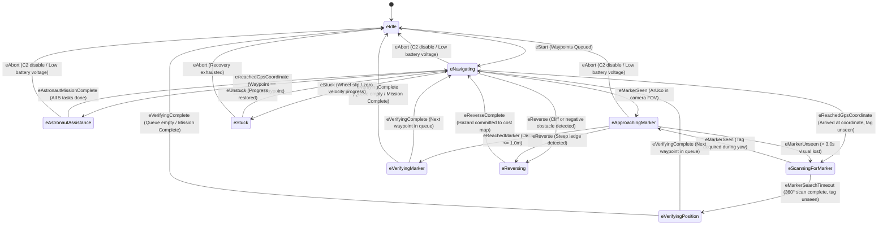

# Design Specification: URC 2027 Core State Machine Architecture & Testing Framework

**Author:** Luke K (Autonomy Lead)  
**Date:** November 5, 2026  
**Status:** Approved  
**Target Milestone:** Software Critical Design Review (CDR) - November 14, 2026  
**Subsystems Affected:** `StateMachineHandler`, `State.hpp`, `NavigatingState`, `AstronautMissionController`, `ScanningForMarkerState`, `ApproachingMarkerState`, `VerifyingMarkerState`, `WaypointHandler`, Obstacle Avoidance

---

## 1. Executive Summary & Architectural Motivation

The University Rover Challenge (URC) 2027 navigation rules fundamentally alter the mission requirements:
1. **Astronaut Assistance Sub-Mission (50 Points):** Demands interactive human-in-the-loop state transitions (`Follow`, `Stay`, `Fetch`, `Come`, `Give`).
2. **Autonomous Route-Finding Sub-Mission (50 Points):** Targets are located on steep, natural desert hills (Target 1: Navigable Hill Ascent; Target 2: Non-LOS Behind Hill).
3. **Exact Coordinates (URC Q&A #16):** Target GNSS coordinates are exact, rendering legacy expanding Archimedean driving spirals obsolete and hazardous on steep hill slopes.

To meet these requirements without creating an unmanageable monolithic state machine, this specification establishes:
* A streamlined **9-state top-level architecture** that purges obsolete loose-object states.
* Replacement of the driving spiral search with an **in-place $360^\circ$ visual scan (`eScanningForMarker`)**.
* **State-aware dynamic safety profiles** that protect against hillside cliff drop-offs while preventing false-positive obstacle stops around human legs.
* A **modular testing harness** allowing individual states and sub-tasks (e.g. testing `Follow` or `Fetch` alone) to be executed in isolation via RoveComm debug injection.

---

## 2. Regulatory & Technical Ground Truth

* **Exact GNSS Coordinates (URC Q&A #16):**  
  * *"Coordinates will be exact. ARUCO tags are to help judges and spectators in the field as much as they are to help the rover get within the 1 m full-scoring distance."*
  * Rationale for eliminating driving spirals: Driving an expanding spiral across a 15-meter radius on a 20-degree hillside risks vehicle tip-over and high-centering.
* **Target Scoring Tolerances (URC Section 1.e.xvii):**  
  * Must autonomously stop within **1.0 meter** of the target location (measured from AR post to closest point of rover).
* **Non-LOS Autonomous Requirement (URC Section 1.e.xvi & Q&A #18):**  
  * Target 2 is situated behind a hill, completely severing radio line-of-sight. The state machine must handle full target verification and waypoint advancement with zero base station communication.

---

## 3. Top-Level State Inventory

The 2027 architecture cleans out legacy loose-object states (`eApproachingObject`, `eVerifyingObject`), isolates astronaut interaction into a sub-state machine, and establishes dedicated marker scanning:

```
+----------------------------------------------------------------------------------------------------+
|                                    URC 2027 STATE MACHINE INVENTORY                                |
+------------------------------------+---------------------------------------------------------------+
| State Enum                         | Primary Function                                              |
+------------------------------------+---------------------------------------------------------------+
| statemachine::States::eIdle        | Holding state. Drivetrain stopped, watchdog active.           |
| statemachine::States::eNavigating  | Global traversal via USGS DEM + 2.5D LiDAR GeoPlanner.        |
| statemachine::States::eAstronaut...| Manages 5-step astronaut sequence (Follow, Stay, Fetch, etc.) |
| statemachine::States::eScanning... | In-place 360-degree yaw scan if tag unseen upon arrival.      |
| statemachine::States::eApproaching.| Visual docking to <= 1.0m of ArUco post with slope safety.    |
| statemachine::States::eVerifying...| 3.0s stationary confirmation + Flashing Green LED.            |
| statemachine::States::eVerifying...| Stationary RTK GNSS confirmation if tag is obscured.          |
| statemachine::States::eReversing   | 1.5 - 2.0m retreat upon detecting negative obstacle or cliff. |
| statemachine::States::eStuck       | Progressive recovery (swerve wiggle, reverse) upon stall/slip.|
+------------------------------------+---------------------------------------------------------------+
```

### Deprecated States (Removed from Core Enum):
* `statemachine::States::eApproachingObject` (Deprecated: Loose mallets/bottles no longer exist in Route Finding; tool pickup is handled by `Fetch` visual servoing).
* `statemachine::States::eVerifyingObject` (Deprecated: Consolidated into `Fetch` sequence).
* `statemachine::States::eSearchPattern` (Replaced by `eScanningForMarker`).

---

## 4. Global State Transition Diagram



---

## 5. Transition Logic & Subsystem Integration

### 5.1 Route Finding: Arrival at Exact Coordinates & In-Place Scanning
1. `eNavigating` drives toward the hill target using 2.5D A* pathing (`GeoPlanner`).
2. If the front ZED camera spots the ArUco marker while in transit ($5-15$ m range), `eMarkerSeen` triggers immediately, bypassing the scan and transitioning directly to `eApproachingMarker`.
3. If the rover reaches the coordinate ($\le 1.5$ m) without visual detection:
   * `eReachedGpsCoordinate` triggers transition to `eScanningForMarker`.
   * Swerve drive executes an in-place yaw rotation at $\omega = 15.0^\circ/\text{s}$.
   * Because the post features tags on three sides, a tag face is brought into view within at most $120^\circ$ of rotation ($8$ seconds).
   * Once acquired with $>80\%$ confidence across 3 frames, `eMarkerSeen` triggers transition to `eApproachingMarker`.
   * If the full $360^\circ$ rotation completes (28-second timeout) without tag detection:
     * `eMarkerSearchTimeout` transitions the rover to `eVerifyingPosition`.
     * The rover verifies RTK GNSS fix quality, holds stationary for 3.0 seconds, flashes the green LED to signal completion, and logs arrival.

### 5.2 Terrain-Safe Marker Approach (`eApproachingMarker`)
Addressing the vulnerability identified in `MRDT Better Pathing doc.md`:
* Previously, `ApproachingMarkerState` drove straight toward the tag coordinates without checking the underlying terrain, creating a cliff-edge hazard on steep desert hills.
* In the updated architecture, `ApproachingMarkerState` performs **terrain-aware local docking**:
  1. The target vector is checked against the local LiDAR elevation grid.
  2. If the direct line-of-sight vector has a slope $>20.0^\circ$ or a negative drop-off, the planner computes a curved approach vector using swerve strafing $(v_x, v_y)$.
  3. The rover approaches the post until the physical bumper is within $0.90$ meters (safely satisfying the $\le 1.0$ m rule).
  4. `eReachedMarker` triggers transition to `eVerifyingMarker`.

### 5.3 Verification & Scoring Confirmation (`eVerifyingMarker`)
1. All drivetrain power is zeroed.
2. Rover holds stationary for $3.0$ seconds to confirm tag stability.
3. RoveComm command `StateDisplay` / `LEDRGB` sets the rear chassis indicator to **Flashing Green** for 3.0 seconds (Rule 1.e.ii).
4. `eVerifyingComplete` pops the completed leg from `WaypointHandler`:
   * If further legs remain: transitions to `eNavigating`.
   * If queue is empty: transitions to `eIdle`.

---

## 6. State-Aware Dynamic Safety Profiles

To support Software CDR Slide 11 (*"Can we disable obstacle avoidance for the astronaut mission?"*), the state machine implements dynamic safety filtering:

```
+------------------------------------+--------------------+--------------------+----------------------+
| Safety System / Threshold          | eNavigating        | eApproachingMarker | eAstronautAssistance |
+------------------------------------+--------------------+--------------------+----------------------+
| Global LiDAR 2.5D Cost Map         | Active (Full A*)   | Active (Slope-only)| Suspended            |
| ZED Stereo Point Cloud Obstacles   | Active (Full check)| Relaxed (Ignore post) Suspended            |
| Slope Safety Threshold             | 20.0 degrees       | 20.0 degrees       | Suspended (Flat)     |
| Negative Obstacle / Cliff Edge     | Active (Triggers Rev) Active (Triggers Rev) Suspended            |
| Human Proximity Standoff Buffer   | Inactive           | Inactive           | Active (2.5m brake)  |
| Downward Visual Servoing           | Inactive           | Inactive           | Active (Fetch only)  |
| IMU Roll/Pitch Tilt Limit (E-stop) | 30.0 degrees       | 30.0 degrees       | 30.0 degrees         |
+------------------------------------+--------------------+--------------------+----------------------+
```

### Implementation in Code:
Each state implements a `GetSafetyProfile()` query. When entering a state, `StateMachineHandler` applies that state's safety profile to `LiDARHandler` and `ObjectDetectionHandler`, adjusting filtering parameters without requiring manual toggling.

---

## 7. Modular Testing & State Injection Framework

To facilitate student subsystem testing (e.g. testing `Follow` without running navigation, testing the downward camera pick-up without walking 20 meters, or verifying swerve drive behaviors in isolation):

### 7.1 Non-Rigid Flow: Direct State Injection
The state machine supports direct state injection via RoveComm UDP/TCP packets:
* `InjectState` (Data ID 11020): `[StateEnum]`
  * Forces the state machine to transition directly to any state (e.g., jump directly into `eApproachingMarker` or `eScanningForMarker`).
* `InjectAstronautSubState` (Data ID 11021): `[SubStateEnum]`
  * Forces `AstronautMissionController` to jump directly into any sub-task (`Sub_AwaitingFollow`, `Sub_DeployingWinch`, `Sub_AwaitingCome`, etc.).

### 7.2 Testing Strategy Matrix

| Testing Level | Scope | Execution Environment | Tools Used |
| :--- | :--- | :--- | :--- |
| **Unit Testing** | Individual controller math & state transitions. | Developer PC / CI | Catch2 test suites, mock RoveComm nodes. |
| **Simulated Sub-Task** | Testing individual tasks (`Follow`, `Fetch`, `Scan`). | Unreal Engine Simulator | Simulated ZED depth feeds, simulated V4L2 downward camera, RoveComm loopback. |
| **Hardware-in-the-Loop** | Testing Autohead winch and gripper pickup. | Electronics Test Bench | Jetson Orin connected to Smoco motor controller via CAN/RoveComm, mock rock pick on floor. |
| **Full Mission Integration** | End-to-end traversal from start to astronaut to hill targets. | Field Testing (Mines Park / Quarry) | Full rover chassis, RTK GNSS base, spacesuit with RIM module. |

---

## 8. State Machine Code Interface Changes

### 8.1 `src/interfaces/State.hpp`
```cpp
namespace statemachine
{
    enum class States
    {
        eIdle,
        eNavigating,
        eAstronautAssistance,
        eScanningForMarker,
        eApproachingMarker,
        eVerifyingMarker,
        eVerifyingPosition,
        eReversing,
        eStuck,
        NUM_STATES
    };

    enum class Event
    {
        eStart,
        eReachedGpsCoordinate,
        eReachedMarker,
        eMarkerSeen,
        eMarkerUnseen,
        eMarkerSearchTimeout,
        eVerifyingComplete,
        eVerifyingFailed,
        eAstronautMissionComplete,
        eAbort,
        eRestart,
        eNoWaypoint,
        eNewWaypoint,
        eReverse,
        eReverseComplete,
        eStuck,
        eUnstuck,
        NUM_EVENTS
    };
}
```

### 8.2 `src/AutonomyConstants.h`
```cpp
namespace constants
{
    // Scanning For Marker State
    const double SCANNING_MARKER_YAW_RATE          = 15.0;  // deg/s
    const double SCANNING_MARKER_TIMEOUT_SECONDS   = 28.0;  // seconds (covers 360 deg + buffer)
    
    // Approaching Marker State
    const double APPROACH_MARKER_MAX_SPEED         = 0.40;  // m/s
    const double APPROACH_MARKER_STOP_DISTANCE     = 0.90;  // meters (URC Rule: <= 1.0m)
    const double APPROACH_MARKER_MAX_SAFE_SLOPE    = 20.0;  // degrees
    
    // Verifying Marker State
    const double VERIFY_MARKER_HOLD_TIME_SECONDS   = 3.0;   // seconds
    const double VERIFY_MARKER_GREEN_FLASH_SECONDS = 3.0;   // seconds
    
    // Dynamic Obstacle Profiles
    const bool ENABLE_ASTRONAUT_OBSTACLE_OVERRIDE  = true;
}
```
